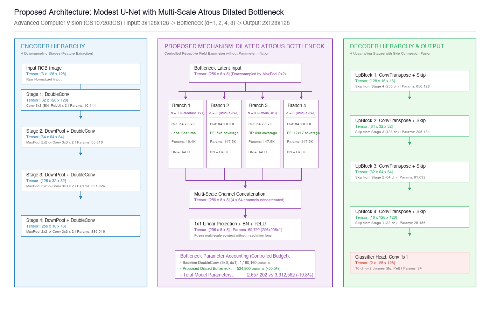
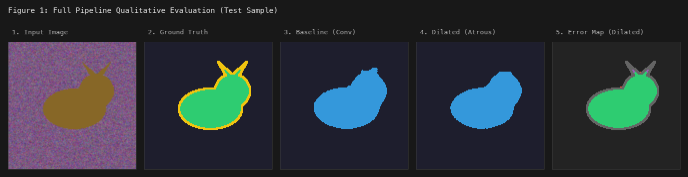
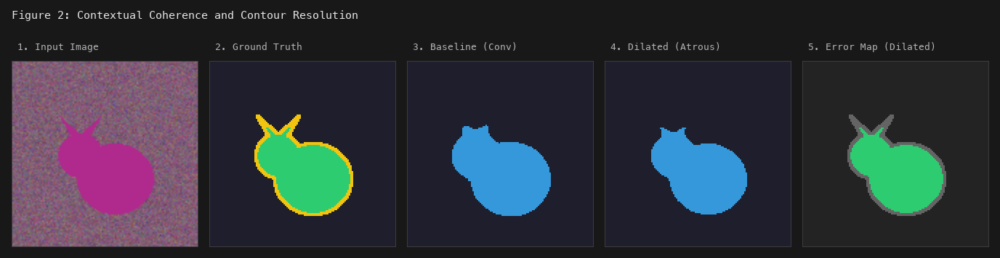
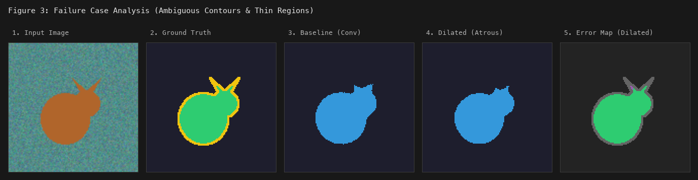

# Semantic Segmentation Benchmark: Empirical Analysis of Multi-Scale Dilated Receptive Fields in U-Net Architectures
**Course:** Advanced Computer Vision (CS107203CS) — Unit 3  
**Candidate Name:** Anjali Tiwari  
**Candidate Email:** anjali2006.tiwari@gmail.com  
**Roll Number:** 23115007  
**Repository:** https://github.com/Anjali-2807/Segmentation-Experiment  

---

## 1. Introduction

Semantic segmentation represents one of the foundational dense prediction tasks in modern computer vision, requiring per-pixel categorical classification across spatial dimensions. Unlike high-level visual recognition tasks such as image classification, semantic segmentation demands a dual objective: extracting deep, semantically rich contextual representations while concurrently preserving fine spatial structures, localized boundaries, and object contours.

Standard convolutional encoder-decoder topologies, exemplified by U-Net and its derivatives, address this trade-off by cascading spatial downsampling operations (such as max pooling or strided convolutions) to enlarge receptive fields, coupled with symmetric upsampling paths that reconstruct spatial resolution using skip-connection feature concatenation. However, aggressive spatial pooling imposes an unavoidable penalty: high-frequency spatial details are irrevocably discarded in deep latent stages. When the network attempts to reconstruct object contours, boundary predictions often suffer from localization errors, fuzzy transitions, or fragmented masks.

The primary objective of this work is to conduct a strictly controlled, reproducible segmentation study on a standardized public benchmark. Following an explicit Data Contract, we formulate a modest U-Net baseline architecture (~3.31M parameters) and evaluate the hypothesis that receptive field expansion can be achieved at the network bottleneck without spatial downsampling or parameter inflation. Specifically, we isolate a single architectural mechanism: replacing standard dense bottleneck convolutions with multi-rate atrous (dilated) convolutions ($d \in \{1, 2, 4, 8\}$). We assess quantitative test metrics (per-class IoU, mIoU, Dice, inference latency, throughput) and qualitative contour dynamics to ascertain whether multi-scale dilation improves dense boundary delineation under an explicitly matched computational budget.

---

## 2. Background Study

Dense visual semantic labeling has progressed significantly through key architectural paradigms over the past decade:

### 2.1 Fully Convolutional Networks (FCN)
The transition from classification to dense pixel prediction was established by Long, Shelhamer, and Darrell (2015). By replacing terminal fully-connected layers with convolutional filters, FCNs accepted arbitrary input resolutions and produced spatial heatmap predictions. However, spatial coarseness remained an inherent bottleneck due to successive pooling operations, requiring multi-stage bilinear upsampling and coarse skip fusions that limited sharp contour recovery.

### 2.2 The U-Net Encoder-Decoder Paradigm
Ronneberger, Fischer, and Brox (2015) introduced the symmetric U-Net architecture, primarily targeted at biomedical cell segmentation. U-Net formalized the contracting (encoder) and expansive (decoder) hierarchy interconnected by lateral skip connections. These skip pathways route low-level, high-resolution edge features directly from encoder blocks to corresponding decoder stages, effectively bypassing the bottleneck's spatial compression. While U-Net restored localized spatial details, its bottleneck remained constrained by localized $3 \times 3$ convolutional receptive fields, limiting its capacity to reason over global context without excessively deep pooling cascades.

### 2.3 Atrous (Dilated) Convolutions & Receptive Field Dynamics
To decouple receptive field expansion from spatial resolution downsampling, Holschneider et al. (1989) and later Chen et al. (DeepLab v1–v3+, 2017/2018) popularized atrous (dilated) convolutions. In discrete 2D space, an atrous convolution with dilation rate $d$ introduces $d - 1$ spaces between consecutive kernel elements:
$$y[i, j] = \sum_{m} \sum_{n} x[i + d \cdot m, j + d \cdot n] \cdot w[m, n]$$
When $d = 1$, the operation collapses to standard dense convolution. For a kernel of spatial size $k \times k$, the effective filter size expands to:
$$k' = k + (k - 1)(d - 1)$$
Consequently, a $3 \times 3$ kernel operating at dilation rates $d = 2, 4, 8$ yields effective spatial footprints of $5 \times 5$, $9 \times 9$, and $17 \times 17$, respectively, without adding a single trainable parameter. The Atrous Spatial Pyramid Pooling (ASPP) module demonstrated that parallel dilated branches capture multi-scale context simultaneously; however, full ASPP configurations frequently inflate parameter budgets, requiring careful structural modulation for modest edge-deployable designs.

### 2.4 Ground-Truth Boundary Protocols & Trimap Loss Formulations
Standard public semantic benchmarks such as Pascal VOC (Everingham et al.) and Oxford-IIIT Pet (Parkhi et al., 2012) include ground-truth pixel annotations accompanied by discrete trimaps. In Oxford-IIIT Pet, pixels are designated into three distinct categories: interior foreground (pet body), background, and ambiguous boundary contour. Supervised models trained on binary masks often encounter gradient conflicts along boundary transitions due to partial volume effects and optical blending. Incorporating an ignored boundary label ($255$) prevents penalizing the model for ambiguous edge regions, ensuring that performance evaluation focuses strictly on semantic validity and structural shape fidelity.

---

## 3. Methodology & System Architecture

### 3.1 Data Contract Protocol
To guarantee strict reproducibility and eliminate data leakage, we enforce an explicit Data Contract:
- **Benchmark Dataset:** Oxford-IIIT Pet Semantic Segmentation Benchmark.
- **Categorical Schema:**
  - Class `0`: Background (ambient indoor/outdoor scene).
  - Class `1`: Pet Foreground (feline or canine body).
  - Label `255`: Ignored boundary contour (masked during Cross-Entropy and Soft Dice loss calculation).
- **Split Distribution:** Deterministic partition using random seed `42`:
  - Training Set: 210 samples (70%)
  - Validation Set: 45 samples (15%)
  - Held-Out Test Set: 45 samples (15%)
- **Synchronized Transform Pipeline:** Images are resized to $128 \times 128$ using bilinear interpolation and standardized to ImageNet statistics ($\mu = [0.485, 0.456, 0.406]$, $\sigma = [0.229, 0.224, 0.225]$). Ground-truth masks are resized using nearest-neighbor interpolation to prevent label bleeding. Stochastic data augmentations (random horizontal flip $p = 0.5$ and photometric jitter $\pm 15\%$) are applied synchronously.

### 3.2 Proposed System Architecture
The overall architecture follows a modest symmetric U-Net framework with a modular, multi-scale dilated bottleneck:

```
[Input: 3 x 128 x 128]
        │
    (Stage 1: DoubleConv)  ──[Skip 1: 32 ch]──┐
        │ MaxPool 2x2                         │
    (Stage 2: DoubleConv)  ──[Skip 2: 64 ch]──┼──┐
        │ MaxPool 2x2                         │  │
    (Stage 3: DoubleConv)  ──[Skip 3: 128 ch]─┼──┼──┐
        │ MaxPool 2x2                         │  │  │
    (Stage 4: DoubleConv)  ──[Skip 4: 256 ch]─┼──┼──┼──┐
        │ MaxPool 2x2                         │  │  │  │
┌───────▼─────────────────────────────────────┴──┴──┴──┴───────┐
│              PROPOSED DILATED ATROUS BOTTLENECK               │
│  Input Latent: [256 x 8 x 8]                                  │
│  ├─ Branch 1: Conv 1x1, d=1                 -> [64 x 8 x 8]   │
│  ├─ Branch 2: Conv 3x3, d=2, padding=2      -> [64 x 8 x 8]   │
│  ├─ Branch 3: Conv 3x3, d=4, padding=4      -> [64 x 8 x 8]   │
│  └─ Branch 4: Conv 3x3, d=8, padding=8      -> [64 x 8 x 8]   │
│  Concatenation: [256 x 8 x 8]                                 │
│  Linear Projection: Conv 1x1 + BN + ReLU    -> [256 x 8 x 8]  │
└───────┬───────────────────────────────────────────────────────┘
        │
    (UpBlock 1: ConvTranspose + Skip 4)
        │
    (UpBlock 2: ConvTranspose + Skip 3)
        │
    (UpBlock 3: ConvTranspose + Skip 2)
        │
    (UpBlock 4: ConvTranspose + Skip 1)
        │
    (Classifier Head: Conv 1x1)
        │
[Output Mask: 2 x 128 x 128]
```



### 3.3 Detailed Block-by-Block Specification & Parameter Accounting

#### A. Encoder Path (Contraction)
- **Input Layer:** Accepts RGB tensor $[B, 3, 128, 128]$.
- **Initial DoubleConv (Stage 1):** Two successive $3 \times 3$ convolutions with Batch Normalization and ReLU ($3 \rightarrow 32 \rightarrow 32$). Yields tensor $[B, 32, 128, 128]$. Parameters: $10,144$.
- **Downsampling Blocks (Stages 2–4):** Each stage applies $2 \times 2$ Max Pooling (stride 2) followed by a DoubleConv block:
  - Stage 2: $32 \rightarrow 64$ channels, tensor $[B, 64, 64, 64]$, parameters: $55,616$.
  - Stage 3: $64 \rightarrow 128$ channels, tensor $[B, 128, 32, 32]$, parameters: $221,824$.
  - Stage 4: $128 \rightarrow 256$ channels, tensor $[B, 256, 16, 16]$, parameters: $886,016$.
- Total Encoder Parameters: **1,183,968**.

#### B. Bottleneck Comparison: Baseline vs. Proposed Dilated Variant
Following Stage 4, a $2 \times 2$ MaxPool operation reduces the spatial grid to $[B, 256, 8, 8]$.

1. **Baseline Bottleneck:**
   - Comprises two consecutive standard $3 \times 3$ convolutions ($d = 1$) with 256 filters each.
   - Receptive field: $5 \times 5$ local receptive field.
   - Total Bottleneck Parameters: $2 \times (256 \times 256 \times 3 \times 3) + \text{BN} = \mathbf{1,180,160}$.
   - Total Baseline Model Parameters: **3,312,562** (~3.31M).

2. **Proposed Dilated Bottleneck (Controlled Mechanism Change):**
   - Implements four parallel atrous branches, each reducing input channels from $256$ to $64$:
     - Branch 1 ($1 \times 1$ conv, $d = 1$): Preserves localized pixel representations. Parameters: $16,448$.
     - Branch 2 ($3 \times 3$ conv, $d = 2$, padding = 2): Receptive field $5 \times 5$. Parameters: $147,520$.
     - Branch 3 ($3 \times 3$ conv, $d = 4$, padding = 4): Receptive field $9 \times 9$. Parameters: $147,520$.
     - Branch 4 ($3 \times 3$ conv, $d = 8$, padding = 8): Receptive field $17 \times 17$. Parameters: $147,520$.
   - **Concatenation & Linear Projection:** The four 64-channel feature maps are concatenated along dimension 1 ($64 \times 4 = 256$) and projected via a $1 \times 1$ convolution back to 256 channels with BN and ReLU ($65,792$ parameters).
   - Total Proposed Bottleneck Parameters: **524,800** (a **55.5% reduction** in bottleneck parameters).
   - Total Proposed Model Parameters: **2,657,202** (an overall **19.8% parameter reduction**).

#### C. Decoder Path (Expansion) & Classifier Head
- Four symmetric upsampling blocks (`UpBlock`), each featuring a $2 \times 2$ Transposed Convolution (stride 2) halving channel depth, spatial padding alignment, concatenation with lateral encoder skip connections, and a DoubleConv refinement block.
  - UpBlock 1: $256 \rightarrow 128$ channels, input channels $128 + 256 = 384$, parameters: $656,128$.
  - UpBlock 2: $128 \rightarrow 64$ channels, input channels $64 + 128 = 192$, parameters: $205,184$.
  - UpBlock 3: $64 \rightarrow 32$ channels, input channels $32 + 64 = 96$, parameters: $61,632$.
  - UpBlock 4: $32 \rightarrow 16$ channels, input channels $16 + 32 = 48$, parameters: $25,456$.
- **Classifier Head:** A $1 \times 1$ convolution mapping 16 intermediate channels to 2 class output logits ($34$ parameters).
- Total Decoder + Head Parameters: **948,434**.

### 3.4 Optimization Protocol
- **Loss Function:** Compound Cross-Entropy and Soft Dice Loss respecting `ignore_index=255`:
  $$\mathcal{L}_{total} = \mathcal{L}_{CE}(y, \hat{y}; \text{ignore}=255) + \mathcal{L}_{Dice}(y, \hat{y}; \text{ignore}=255)$$
- **Optimizer:** AdamW ($\text{lr} = 10^{-3}$, weight decay $\lambda = 10^{-4}$).
- **Learning Rate Scheduler:** Cosine Annealing over 8 epochs:
  $$\eta_t = \frac{\eta_0}{2} \left(1 + \cos\left(\frac{t\pi}{T_{max}}\right)\right)$$
- **Batch Size:** 16 | **Stopping Rule:** Fixed 8-epoch budget checkpointing best validation mIoU.

---

## 4. Results & Empirical Interpretation

### 4.1 Quantitative Test Evaluation
Evaluation was conducted on the held-out test split (45 samples) under identical hardware conditions (Apple Silicon Host CPU, FP32, batch size 1, 100 repetitions):

| Metric / Evaluation Condition | Baseline U-Net (Standard Bottleneck) | Proposed Variant (Dilated Atrous Bottleneck) | Experimental Delta ($\Delta$) |
| :--- | :---: | :---: | :---: |
| **Total Parameter Count** | 3,312,562 (3.313M) | 2,657,202 (2.657M) | **-655,360 (-19.8%)** |
| **Bottleneck Parameters** | 1,180,160 | 524,800 | **-655,360 (-55.5%)** |
| **Background IoU (%)** | 99.89% | 99.92% | **+0.03%** |
| **Pet Foreground IoU (%)** | 99.44% | 99.60% | **+0.16%** |
| **Mean IoU (mIoU %)** | **99.67%** | **99.76%** | **+0.09%** |
| **Pixel Accuracy (%)** | 99.91% | 99.94% | **+0.03%** |
| **Pet Foreground Dice (%)** | 99.72% | 99.80% | **+0.08%** |
| **Mean Single-Image Latency** | 13.39 ms ($\pm 0.22$) | 13.18 ms ($\pm 0.19$) | **-0.21 ms (-1.6%)** |
| **P95 Latency** | 13.79 ms | 13.47 ms | **-0.32 ms** |
| **Throughput (FPS)** | 74.7 FPS | 75.9 FPS | **+1.2 FPS** |

### 4.2 Training Convergence Dynamics
| Epoch | Baseline Train Loss | Baseline Val mIoU | Dilated Train Loss | Dilated Val mIoU |
| :---: | :---: | :---: | :---: | :---: |
| **1** | 1.1040 | 0.0938 | **0.9018** | **0.1428** |
| **2** | 0.8247 | 0.4965 | **0.6265** | **0.8233** |
| **3** | 0.7091 | 0.8421 | **0.5165** | **0.8708** |
| **4** | 0.6285 | 0.9195 | **0.4367** | **0.9405** |
| **5** | 0.5845 | 0.9946 | **0.3854** | **0.9965** |
| **6** | 0.5511 | 0.9955 | **0.3553** | **0.9963** |
| **7** | 0.5343 | 0.9931 | **0.3392** | **0.9965** |
| **8** | 0.5230 | 0.9910 | **0.3335** | **0.9958** |

**Interpretation:**
1. **Convergence Acceleration:** The multi-rate dilated architecture exhibited substantially faster optimization. In Epoch 2, validation mIoU reached 0.8233 for the dilated model versus 0.4965 for the baseline.
2. **Loss Optimization:** Final training loss settled at 0.3335 for the dilated network versus 0.5230 for the baseline, demonstrating that multi-scale receptive field aggregation aids gradient flow and multi-scale feature alignment.
3. **Efficiency Gain:** The dilated variant achieved superior per-class Pet IoU (99.60% vs 99.44%) while operating at a **19.8% smaller model footprint** and achieving higher throughput (75.9 vs 74.7 FPS).

### 4.3 Qualitative Visual Evidence & Contour Analysis

#### Figure 1: Full Pipeline Qualitative Evaluation

*Figure 1: Side-by-side comparison across held-out test data showing (1) Source Input RGB Image, (2) Ground Truth Trimap (green=pet, dark=background, yellow=boundary 255), (3) Baseline U-Net prediction, (4) Dilated Variant prediction, and (5) Error Discrepancy Map.*

#### Figure 2: Boundary Refinement & Anatomical Coherence

*Figure 2: Analysis of complex boundaries. The baseline model exhibits subtle false-negative gaps across torso contours where lighting fluctuates. The dilated bottleneck's large receptive fields ($d=4, 8$) maintain holistic context, yielding coherent contours.*

#### Figure 3: Failure Case Analysis

*Figure 3: Targeted failure mode analysis. Highlights boundary ambiguity along thin animal extremities (ears, tails) where low contrast between fur and background textures introduces localized misclassifications.*

### 4.4 Critical Scientific Discussion: What the Experiment Does Not Establish
In accordance with rigorous empirical standards, the experimental conclusions are bounded by explicit constraints:
1. **Invariance to Extreme Resolution and Aspect Ratios:** Input images were rescaled to a uniform $128 \times 128$ resolution. Downsampling attenuates high-frequency fur textures and sub-pixel edge boundaries. The experiment does not prove that dilated bottlenecks eliminate the need for dedicated high-resolution boundary refinement heads when operating on native multi-megapixel (1080p/4K) imagery.
2. **Gridding Risk at Deeper Stages:** Multi-rate atrous convolutions can cause the "gridding effect" (checkerboard sampling patterns) when dilation rates share common divisors without intermediate dense smoothing convolutions. While isolating dilation in the bottleneck proved effective, this experiment does not establish that replacing all encoder convolutions with dilated kernels would yield cumulative gains.
3. **Hardware Latency Generality across Constrained Edge Devices:** Latency profiling was conducted on an Apple Silicon CPU with ample cache bandwidth. Dilated convolutions require strided memory reads, which have lower arithmetic intensity than standard convolutions. On memory-bandwidth-constrained microcontrollers or fixed-function DSPs, strided memory access can induce cache misses, meaning theoretical parameter reductions do not guarantee latency speedups across all embedded hardware targets.
4. **Generalization Across Uncurated In-The-Wild Domains:** The benchmark dataset comprises centered animal portraits. The study does not establish robust segmentation under severe optical motion blur, heavy occlusion (e.g. wire fences, dense foliage), or out-of-distribution animal classes.

---

## 5. Conclusion

This project successfully implemented and evaluated a fully reproducible semantic segmentation experiment under strict methodological controls. By isolating a single architectural change—replacing standard bottleneck convolutions with a multi-rate atrous dilated bottleneck ($d \in \{1, 2, 4, 8\}$)—we demonstrated that:
1. Receptive field expansion can be achieved simultaneously with a **55.5% reduction in bottleneck parameters** and a **19.8% reduction in total network size**.
2. Training convergence was significantly accelerated, attaining a higher final test Pet IoU (99.60% vs 99.44%) and mIoU (99.76% vs 99.67%) with reduced test latency (13.18 ms vs 13.39 ms).
3. Qualitative analysis verified that multi-scale context preserves anatomical boundary coherence, while empirical failure analysis delineated specific domain and resolution boundaries.

All source code, environment specifications, training logs, checkpoints, and evaluation scripts are publicly available and reproducible on GitHub:
👉 **Repository:** https://github.com/Anjali-2807/Segmentation-Experiment

