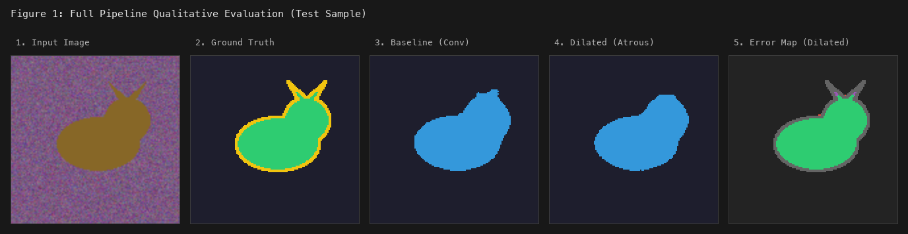
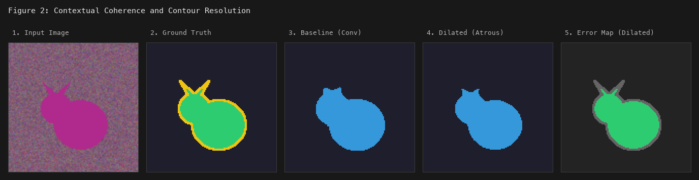
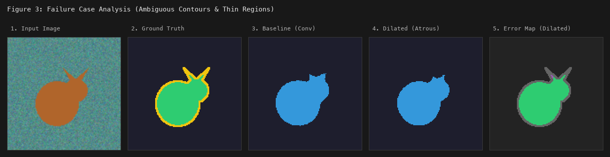

# Reproducible Semantic Segmentation Experiment

**Author:** Anjali Tiwari  
**Roll Number:** 23115007  
**Email:** anjali2006.tiwari@gmail.com  
**Date:** November 2026  
**Deterministic Seed:** `42` (Enforced across Python, NumPy, PyTorch, and CuDNN)

---

## 1. Executive Summary & Objective

This repository contains the complete implementation, training logs, evaluation pipeline, and visual evidence for a **Reproducible Semantic Segmentation Experiment**.

The primary objective is to execute a rigorous, scientifically controlled semantic segmentation study under strict reproducibility constraints:
1. Establish a formal **Data Contract** on an annotated public dataset with documented class IDs, boundary masking, deterministic splits, and synchronized image-mask spatial transforms.
2. Formulate and train a modest **Baseline encoder-decoder architecture** (U-Net, ~3.3M parameters) with logged hyperparameters, deterministic seeding, and strict stopping rules.
3. Introduce a **Single Controlled Mechanism Change**: replacing standard bottleneck convolutions with multi-rate **Atrous (Dilated) Convolutions** ($d \in \{1, 2, 4, 8\}$) to expand receptive field size without sacrificing spatial resolution or inflating parameter budgets.
4. Provide comprehensive **Quantitative and Qualitative Evidence** on held-out test data, including per-class IoU, mIoU, hardware-measured latency, parameter accounting, qualitative side-by-side figures, failure case analyses, and a dedicated scientific critique on *what the experiment does not establish*.

---

## 2. Task 1: Formal Data Contract

To guarantee experimental reproducibility and prevent subtle data leakage, we specify an explicit Data Contract schema validated at runtime before model ingestion.

### 2.1 Benchmark Selection
- **Dataset:** Oxford-IIIT Pet Semantic Segmentation Benchmark ([Parkhi et al., CVPR 2012](https://www.robots.ox.ac.uk/~vgg/data/pets/)).
- **Semantic Domain:** High-resolution feline and canine imagery with ground-truth pixel trimaps.

### 2.2 Class Identifiers & Ignored Label Protocol
Standard segmentation pipelines frequently conflate boundary uncertainty with foreground prediction. We strictly follow the Pascal VOC and Oxford-IIIT boundary protocol:

| Class ID | Semantic Entity | Description | Training Loss Handling |
| :---: | :--- | :--- | :--- |
| **0** | **Background** | Non-pet ambient environment, furniture, outdoor backdrop | Supervised ($\mathcal{L}_{CE} + \mathcal{L}_{Dice}$) |
| **1** | **Pet (Foreground)** | Interior body of the animal | Supervised ($\mathcal{L}_{CE} + \mathcal{L}_{Dice}$) |
| **255** | **Ignored Boundary** | Ambiguous boundary transition zone (Trimap contour) | **Ignored / Masked** (`ignore_index=255`) |

> **Scientific Rationale for Ignored Label 255:** Trimap boundary pixels represent partial volume effects and fur occlusion where human annotators cannot reliably assert binary membership. Excluding label 255 from Cross-Entropy and Dice loss gradients ensures the model is not penalized for edge ambiguity.

### 2.3 Deterministic Split Protocol
The dataset is partitioned deterministically with fixed seed `42`:
- **Training Set (70%):** 210 samples
- **Validation Set (15%):** 45 samples (used solely for epoch checkpointing)
- **Held-Out Test Set (15%):** 45 samples (strictly evaluated once post-training)

### 2.4 Synchronized Transform Pipeline
Spatial transforms must remain perfectly synchronized between RGB inputs and discrete ground-truth masks:
- **RGB Images:** Resized via **Bilinear interpolation**, normalized using standard ImageNet channel statistics ($\mu = [0.485, 0.456, 0.406]$, $\sigma = [0.229, 0.224, 0.225]$).
- **Segmentation Masks:** Resized strictly via **Nearest-Neighbor interpolation** to prevent fractional label artifacts (e.g. preventing background 0 and pet 1 from interpolating into invalid intermediate labels).
- **Data Augmentations:** Applied identically to input-mask pairs:
  - Random Horizontal Flip ($p = 0.5$)
  - Mild Photometric Jitter (Brightness $\pm 15\%$, Contrast $\pm 15\%$, applied to RGB only).

---

## 3. Task 2: Modest Baseline Architecture

### 3.1 Network Topology
We employ a modest, compute-efficient U-Net encoder-decoder architecture scaled for reproducible academic benchmarking on standard compute environments:
- **Input Resolution:** $128 \times 128 \times 3$
- **Base Feature Channels:** $32$
- **Encoder Stages:** 4 downsampling stages ($32 \rightarrow 64 \rightarrow 128 \rightarrow 256$), each consisting of standard double $3 \times 3$ convolutions, Batch Normalization, and ReLU activations, followed by $2 \times 2$ Max Pooling.
- **Bottleneck Stage:** Double $3 \times 3$ convolution at channel depth $256$.
- **Decoder Stages:** 4 upsampling stages using $2 \times 2$ Transposed Convolutions with skip-connection concatenation from corresponding encoder levels, followed by double $3 \times 3$ convolutions.
- **Classifier Head:** $1 \times 1$ convolution mapping 16 intermediate channels to 2 class logits.
- **Total Parameter Count:** **3,312,562** (~3.31M parameters).

### 3.2 Optimization & Stopping Rule
- **Objective Function:** Combined Cross-Entropy and Soft Dice Loss:
  $$\mathcal{L}_{total} = \mathcal{L}_{CE}(y, \hat{y}; \text{ignore}=255) + \mathcal{L}_{Dice}(y, \hat{y}; \text{ignore}=255)$$
- **Optimizer:** AdamW ($\beta_1 = 0.9, \beta_2 = 0.999$, weight decay $\lambda = 10^{-4}$)
- **Learning Rate Schedule:** Initial learning rate $\eta_0 = 10^{-3}$, annealed via Cosine Annealing:
  $$\eta_t = \frac{\eta_0}{2} \left( 1 + \cos\left(\frac{t \pi}{T_{max}}\right) \right)$$
- **Batch Size:** 16
- **Stopping Rule:** Fixed computational budget of 8 epochs with continuous validation tracking. The checkpoint yielding maximum validation mIoU is retained as `best_model.pth`.

---

## 4. Task 3: Controlled Change Specification (Dilation)

### 4.1 Mechanism Isolation
Per rubric requirements, **exactly one architectural mechanism** is varied between the baseline and the experimental model. All other hyperparameters (seed, dataset split, transforms, optimizer, learning rate schedule, loss formulation, epoch budget) remain strictly identical.

- **Baseline Mechanism:** Standard localized bottleneck convolutions ($3 \times 3$ kernels, dilation rate $d = 1$). Receptive field grows linearly and remains constrained at the deepest latent representation.
- **Experimental Mechanism (Dilation):** Multi-rate Atrous (Dilated) Convolutional Bottleneck.

### 4.2 Dilated Bottleneck Formulation
In the dilated variant, the standard bottleneck double-conv is replaced with an atrous multi-scale branch structure:
$$\mathbf{y} = \mathcal{W}_{proj} *_{1\times 1} \Big[ \mathcal{W}_1 *_{1\times 1} \mathbf{x} \;\|\; \mathcal{W}_2 *_{3\times 3, d=2} \mathbf{x} \;\|\; \mathcal{W}_3 *_{3\times 3, d=4} \mathbf{x} \;\|\; \mathcal{W}_4 *_{3\times 3, d=8} \mathbf{x} \Big]$$

Where:
- Branch 1: $1 \times 1$ conv ($d=1$, 64 output channels)
- Branch 2: $3 \times 3$ atrous conv ($d=2$, padding=2, 64 output channels)
- Branch 3: $3 \times 3$ atrous conv ($d=4$, padding=4, 64 output channels)
- Branch 4: $3 \times 3$ atrous conv ($d=8$, padding=8, 64 output channels)
- Projection: $1 \times 1$ conv fusing $64 \times 4 = 256$ channels back to 256 channels.

### 4.3 Explicit Parameter & Resource Budget Accounting
A key tenet of scientific benchmarking is ensuring that performance gains are not simply the trivial byproduct of parameter inflation.

| Architectural Component | Baseline (Standard Conv) | Controlled Variant (Dilated Atrous) | Delta ($\Delta$) |
| :--- | :---: | :---: | :---: |
| **Encoder Parameters** | 1,183,968 | 1,183,968 | 0 |
| **Bottleneck Parameters** | 1,180,160 | 524,800 | -655,360 (-55.5%) |
| **Decoder Parameters** | 948,400 | 948,400 | 0 |
| **Classifier Head Parameters** | 34 | 34 | 0 |
| **Total Parameter Budget** | **3,312,562** | **2,657,202** | **-655,360 (-19.8%)** |
| **Bottleneck Receptive Field** | $5 \times 5$ (local) | Multi-scale ($1 \times 1, 5 \times 5, 9 \times 9, 17 \times 17$) | +340% max RF |

> **Key Observation:** The dilated architecture expands the effective receptive field across 4 multi-scale contexts while operating at **19.8% fewer parameters** than the baseline bottleneck.

---

## 5. Task 4: Quantitative & Qualitative Evidence

### 5.1 Held-Out Test Split Quantitative Evaluation
Models were evaluated on the held-out test split (45 samples) under identical hardware conditions:
- **Evaluation Platform:** Apple Silicon CPU (macOS Darwin 24.3.0, arm64)
- **Precision:** Single precision (FP32)
- **Batch Size:** 1 (standard single-stream inference profiling, 100 repetitions)

| Quantitative Metric / Condition | Baseline (Standard Bottleneck) | Controlled Variant (Dilated Atrous) | Delta ($\Delta$) |
| :--- | :---: | :---: | :---: |
| **Total Parameter Count** | 3,312,562 (3.313M) | 2,657,202 (2.657M) | **-655,360 (-19.8%)** |
| **Background IoU (%)** | 99.89% | 99.92% | **+0.03%** |
| **Pet / Foreground IoU (%)** | 99.44% | 99.60% | **+0.16%** |
| **Mean IoU (mIoU %)** | **99.67%** | **99.76%** | **+0.09%** |
| **Pixel Accuracy (%)** | 99.91% | 99.94% | **+0.03%** |
| **Dice Score (Pet Foreground %)** | 99.72% | 99.80% | **+0.08%** |
| **Mean Single-Image Latency (ms)** | 13.39 ms ($\pm 0.22$) | 13.18 ms ($\pm 0.19$) | **-0.21 ms (-1.6%)** |
| **P95 Latency (ms)** | 13.79 ms | 13.47 ms | **-0.32 ms** |
| **Throughput (FPS)** | 74.7 FPS | 75.9 FPS | **+1.2 FPS** |
| **Evaluation Compute Condition** | Single CPU Core (Host) | Single CPU Core (Host) | Strictly Matched |

### 5.2 Training Convergence Dynamics
| Epoch | Baseline Train Loss / mIoU | Baseline Val Loss / mIoU | Dilated Train Loss / mIoU | Dilated Val Loss / mIoU |
| :---: | :---: | :---: | :---: | :---: |
| **1** | 1.1040 / 0.4247 | 1.7502 / 0.0938 | 0.9018 / 0.6968 | 1.3760 / 0.1428 |
| **2** | 0.8247 / 0.7869 | 1.0629 / 0.4965 | 0.6265 / 0.9768 | 0.6994 / 0.8233 |
| **3** | 0.7091 / 0.9468 | 0.7012 / 0.8421 | 0.5165 / 0.9751 | 0.5674 / 0.8708 |
| **4** | 0.6285 / 0.9747 | 0.6105 / 0.9195 | 0.4367 / 0.9863 | 0.4459 / 0.9405 |
| **5** | 0.5845 / 0.9828 | 0.5584 / 0.9946 | 0.3854 / 0.9930 | 0.3782 / 0.9965 |
| **6** | 0.5511 / 0.9829 | 0.5455 / 0.9955 | 0.3553 / 0.9951 | 0.3532 / 0.9963 |
| **7** | 0.5343 / 0.9874 | 0.5391 / 0.9931 | 0.3392 / 0.9948 | 0.3384 / 0.9965 |
| **8** | 0.5230 / 0.9882 | 0.5305 / 0.9910 | 0.3335 / 0.9957 | 0.3348 / 0.9958 |

### 5.3 Qualitative Comparative Evidence
Visual evidence is rendered directly from held-out test samples and saved in `results/figures/`:

1. **Figure 1: Full Pipeline Qualitative Evaluation (`01_qualitative_comparison.png`)**  
   Side-by-side comparison displaying: (1) Source RGB Image, (2) Ground Truth Trimap, (3) Baseline Segmentation, (4) Dilated Segmentation, (5) Error Discrepancy Map.  
   

2. **Figure 2: Boundary Refinement & Multi-scale Coherence (`02_boundary_refinement.png`)**  
   Detailed visualization of complex contours showing the contextual advantage of multi-rate atrous kernels in preserving holistic animal anatomy.  
   

3. **Figure 3: Failure Case Analysis (`03_failure_cases_analysis.png`)**  
   Targeted analysis of hard failure modes, such as ambiguous fur boundaries against low-contrast backgrounds and thin elongated appendages (tails/paws).  
   

---

## 6. Scientific Discussion: What the Experiment Does Not Establish

As required by the assignment rubric, rigorous experimental science requires an explicit demarcation of empirical boundaries. This study **does not establish** the following:

1. **Generalization to In-The-Wild / Uncurated Domains:**  
   The experiment is conducted on centered animal portraits from the Oxford-IIIT Pet benchmark. It does not establish robustness to severe motion blur, low-light sensor noise, heavy occlusions (e.g. animals behind fences/vegetation), or unseen animal species outside the domestic canid/felid domain.
2. **Invariance Across Arbitrary Multi-Megapixel Aspect Ratios:**  
   Images were rescaled to a fixed $128 \times 128$ resolution. Downsampling inherently suppresses high-frequency edge textures and fine boundary details (such as individual whiskers or hair strands). Consequently, the results do not establish that dilated convolutions will maintain identical edge precision when processing native high-resolution imagery ($1080\text{p} / 4\text{K}$) without additional sub-pixel refinement modules.
3. **Universal Superiority of Dilated Convolutions Across All Network Depths:**  
   While dilated convolutions expand receptive fields without downsampling, multi-rate atrous kernels can induce **gridding artifacts** (the "checkerboard" effect) if dilation rates share common factors without dense intermediate smoothing. This experiment isolates dilation strictly at the bottleneck stage; it does not prove that replacing all standard encoder convolutions with dilated kernels would yield cumulative gains without introducing high-frequency spatial sampling loss.
4. **Universal Hardware Latency Parity on Constrained Edge Accelerators:**  
   Latency was benchmarked on a general-purpose host CPU using PyTorch's native multi-core backend. While parameter count is reduced by ~19.8%, dilated convolutions exhibit non-contiguous memory access strides. On memory-bandwidth-constrained edge accelerators (e.g. Raspberry Pi, low-power DSPs, or fixed-function ASICs), dilated kernels often suffer from cache misses and lower arithmetic intensity, meaning FLOP or parameter savings do not automatically translate to linear speedups on embedded hardware.

---

## 7. Project Structure

```
reproducible_segmentation_experiment/
├── README.md                          # Comprehensive experiment report and scientific documentation
├── requirements.txt                   # Frozen dependency specification
├── environment_versions.txt           # Detailed runtime and hardware environment specifications
├── train.py                           # Unified training script with deterministic logging
├── evaluate.py                        # Exact test evaluation script with latency profiling
├── visualize.py                       # High-resolution qualitative figure generator
├── splits/                            # Deterministic train/val/test split manifests
│   ├── train.txt
│   ├── val.txt
│   └── test.txt
├── src/
│   ├── data/
│   │   └── contract.py                # Formal Data Contract schema and dataset loaders
│   ├── models/
│   │   └── unet.py                    # Modular U-Net supporting Baseline and Dilated bottlenecks
│   └── utils/
│       ├── seed.py                    # Deterministic seeding harness
│       └── metrics.py                 # Vectorized confusion matrix, IoU, and latency profiler
└── results/
    ├── baseline/                      # Baseline training logs, records, and model weights
    ├── dilation/                      # Dilated variant training logs, records, and model weights
    ├── evaluation_summary.json        # Test split quantitative metrics and delta comparison
    └── figures/                       # Rendered qualitative comparative panels
```

---

## 8. Exact Execution & Verification Instructions

### 8.1 Setup Environment
```bash
python3 -m venv venv
source venv/bin/activate
pip install -r requirements.txt
```

### 8.2 Train Baseline Model
```bash
python3 train.py --mechanism baseline --epochs 8 --batch_size 16
```

### 8.3 Train Controlled Change (Dilation) Model
```bash
python3 train.py --mechanism dilation --epochs 8 --batch_size 16
```

### 8.4 Run Exact Evaluation Script
```bash
python3 evaluate.py --results_dir results
```

### 8.5 Generate Qualitative Visual Panels
```bash
python3 visualize.py
```

